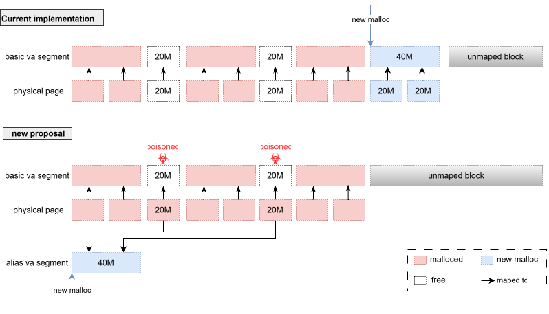
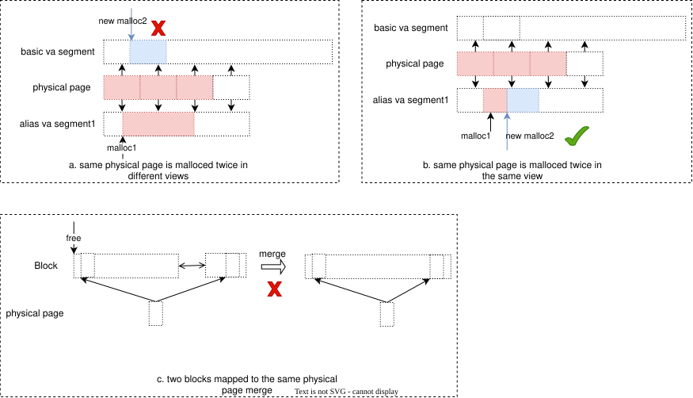

# 空闲物理页二次映射复用（`expandable_segments_idle_remap`）

**Authors:**

- @Stevennnn

## **Summary**

`expandable_segments:True`配置下，当空闲block不满足分配时，优先收集空闲的物理页，新 `cuMemAddressReserve` 一段恰好够用的连续 VA（**称为别名段，原va段称为基础段**），把空闲的物理块**在不调用cuMemUnmap的前提下**二次 `cuMemMap` 到别名段上，无需流同步。



一个物理页相当于有了多个view，同一时刻只允许一个view处于active状态。记录物理页handle映射的所有VA段，

demo版本显示该方案能利用每一个物理块，并且内存池malloc性能损失小于10%，整网性能影响小到可忽略。

## **Motivation**

`expandable_segments:True` 先预留一大段虚拟地址，再按需申请物理块做映射，虚拟地址相邻的空闲块可以合并，已经在很大程度上解决了内存池的碎片问题。

但一次分配仍然要落在一段连续的虚拟地址上，而合并只发生在虚拟地址相邻的空闲块之间。被活跃分配夹在中间的空闲块因此无法与其它空闲块拼起来：它的物理块是空闲的，却凑不出一次大分配所需的连续地址。于是当已映射的空闲 block 无法满足分配时，分配器只能申请新的物理块，而那些分散的空闲块继续占着设备内存。

结果是内存利用率（tensor 申请的内存大小 / 内存池缓存的内存大小）下降。这些空洞随训练步数累积，所以不是一次性的浪费，而是利用率随时间持续走低。当模型所需内存接近设备总内存时，即使空闲物理总量足够，也会因为凑不出连续地址而 OOM。

## **Proposed Implementation**

### 术语


| 术语                   | 含义                                                                                                                                                                                                    |
| -------------------- | ----------------------------------------------------------------------------------------------------------------------------------------------------------------------------------------------------- |
| **物理页**              | torch内存池中大池每次申请的物理块，当前是20M。                                                                                                                                                                           |
| **基础段**              | 现有实现中， `ExpandableSegment` 构造时按 `device_total×1.125` 预留的 VA。物理页会先和基础段做映射，然后再和别名段做映射。                                                                                                                  |
| **别名段**              | 本特性为一次请求新 reserve 的一段连续 VA，打 `is_alias_segment_` 标记。按请求精确取 `ceil(need_size / segment_size)` 页，一次拼成，此后不增长。段内允许多块、允许 split。**是"纯别名段"**：段内映射的任何物理页也都先映射到了基础段。                                            |
| **Block**            | 内存池管理 VA 的基本单位：一段连续的 VA 区间，带已分配/空闲状态。分配时从空闲 Block 中切出（split），释放时与相邻的空闲 Block 合并（merge），同一段内的 Block 按地址串成链表。Block 与物理页是多对多关系：一个 Block 可以跨多个物理页，也可以只占一个物理页的一部分（如 20MB 页上的前 5MiB），所以账本以物理页而不是 Block 为单位。 |
| **供体**               | 收集基础段里完整空闲的物理页，**不解除它原有的映射**, 重新映射到别名段。                                                                                                                                                               |
| **账本**               | 记录一个物理页映射到了哪些段，在段中对应的索引。                                                                                                                                                                              |
| **view(视图)**         | 一个物理页映射到多个段，每个段相当于这个物理页的视图。                                                                                                                                                                           |
| **active段/active视图** | 物理页在哪个段上被分配了，这个段被称为active段，也称active视图。同一物理页任一时刻至多一个active段。                                                                                                                                           |
| **中毒**               | 比如一个物理页同时映射到了段A的block\_a，段B的block\_b，如果block\_b被申请走了，那么block\_a就不能再被分配了，形象的描述为“中毒”了。                                                                                                                  |


### 保证内存分配正确性的机制

同一个物理页映射到多个虚拟地址段，对应多个Block，Block可以切分与合并，在这个过程中需要保证正确性--一块物理内存同一时刻只能有一个block分配，下面列出了几种故障模式及如何从机制上避免这种错误。


#### 同一块物理内存映射的block，同一时刻只能有一个被分配出去

如图a中所示，物理页同时映射到基础段和别名段1，malloc1位于别名段1，此时new malloc2应该被禁止。而如图b所示，已存在malloc1被分配，new malloc2 block虽然和malloc1 block映射了同一个物理页，但是所对应物理页内偏移不同，因此可以被分配。为了满足这两种场景，设计机制如下：

（1）新增一个账本，记录了物理页映射的所有虚拟段，注意不是block，并记录了active段。账本挂在 `BlockPool` 上，核心数据结构如下：

```cpp
// 物理页在某个段中的位置
struct AliasMapPoint {
  ExpandableSegment* seg;   // 所在的段
  size_t index;             // 在该段中的页索引
};

// 账本表项：一个物理页的全部映射，以及它当前在哪个段上被分配
struct PhysicalHandleLedger {
  c10::SmallVector<AliasMapPoint, 4> points;  // 映射到的所有段
  ExpandableSegment* active = nullptr;        // active 段，nullptr 表示整页空闲
};

// 账本：物理页 handle -> 表项，挂在 BlockPool 上
ska::flat_hash_map<PhysicalHandleKey, PhysicalHandleLedger> aliased_handles_;
```

- **`active` 是段指针。** 同一个段对同一个物理页可以有多个 Block 被分配（如图b），它们的 `active` 指向同一个段，互不冲突。

（2）`active` 的置与清口径不对称：

- **置：** Block 被分配时，对它**触及**的每个物理页置 `active = Block 所在的段`，有任何重叠即算，不要求完整覆盖。Block 常常只占物理页的一部分，如果要求完整覆盖才置，该页的剩余部分会被另一个视图当作干净页分配出去，造成同页双写。
- **清：** Block 释放并与相邻空闲 Block 合并之后，仅当物理页被合并后的空闲 Block **完整包含**时才置 `active = nullptr`，即该视图在这个物理页上已经没有任何活跃分配。先合并**后**清：部分覆盖某页的 Block，在合并之前不会被完整包含。
- 这里的设计要点是**先合并后清**。在判断物理页的active转为nullptr时，并没有使用引用计数（比如物理页对应的block malloc时，计数++， block free时计数--），而是判断物理页是否被合并后的空闲block完整包含。
- 要严格遵守的一个约束是，相邻free+mapped block必须merge，无论是否“中毒”。否则上面的判断条件就不准确。本方案能保证满足这个约束。

（3）在best-fit流程中，找到size合适的block后，需要遍历该block映射的所有物理页，查询账本中记录的active段，如果active段非空且指向其他段，则block上被该物理页映射的地址范围处于“中毒”状态，block不能直接被分配，需要进一步找到连续“非中毒”段进行分配。

#### 同一个物理页映射的2个block不能合并

如图c中所示，两个Block中都有一块虚拟地址映射到了同一个物理页，合并后的block分配给算子会导致精度问题，因此这样的合并是没有意义的。而Block合并前如果增加检查会导致合并性能降低。因此有如下设计，从机制上保证不会发生这种合并：

（1）别名段映射的物理页只有一个来源，就是收集基础段的完整空闲物理页，当空闲物理页不足时，新申请的物理页也必须先映射到基础段。

（2）别名段按照`ceil(need_size / segment_size)`进行reserve，并全部做好映射。

这种设计保证了一个段内物理页不会重复；另外，一个物理页可能会映射到2个block，但是这2个block必然分别属于不同的段，必然不会合并。  

### 提升性能的机制

1. 仅映射到基础段上的物理页，不在账本中记录。

【图】补充alias的占比，每个用例

1. 查询空闲block时，也就是get_free_block函数中，首先查询基础段中的，如果找不到再查询别名段中的。

基础段地址空间大，可扩展性更好。别名段中的分配会导致基础段中的空洞，触发创建更多的别名段，

【图】补充每个用例的数据，体现耗时及alias seg个数增加百分比

1. 展位


&nbsp;

&nbsp;

&nbsp;

&nbsp;

#### 1. 一个 block 被分配出去：置 active 按"触及"，清按"整页包含"

`active` 的置与清口径**刻意不对称**：

- **置（`markPagesActive`，交付时）**：对交付块**触及**的每个物理页（有任何重叠即算，不要求完整覆盖）置 `active = 本 block 所在段`。切分不按页边界对齐，交付块常只覆盖一个页的一部分（20MB 页上的前 5MiB），此时这个页也必须置 active——否则别的视图会把它当干净页交付，造成同页双写。
- **清（`clearPagesActive`，释放时）**：仅当页区间被释放后的块**完整包含**时才置 `active = nullptr`，即"本视图在这个页上已无任何活跃 VA"。

所以"整页"一词只用于描述空闲，不用于限定占用。判定沿用基线分配器已有的几何包含方法（`try_merge_blocks` 保证相邻 free+mapped 块已合并，故整页空闲必对应单个足够大的 free block），**不引入 per-page refcount**。

清的时机是 `free_block` 里**合并之后**。先清会漏：部分覆盖某页的块，在合并前不被完整包含。而合并又带来一个新约束——

**相邻 free 块必须保持已合并。** `free_block` 对 prev/next **无条件**合并，不比较邻居的 `active`。prev/next 与本块 VA 相邻、必属同一段，共用同一个段参数判页可用性，合并后仍在本段视图内。跨视图的中毒页由分配期处理（下一节），不靠释放期拒绝合并来规避。反之，若释放期按 `active` 拒合，会留下本可合并的碎块，破坏 `clearPagesActive` 依赖的"合并后的块即本视图完整空闲范围"这个前提，反而清不干净。

这条不变量在**分配期**也要维护，这是三段切分引入的新情况。基线下 `pool.blocks` 里块的邻居恒非 free（否则早被合并），所以切出余量后直接 insert 不会产生相邻 free 对。但页感知切分把前/后余量作为 free 块插回后，交付块两侧就坐着 free 邻居，此后两处基线切分点（`alloc_found_block` 的 `should_split` 分支、`malloc` 里的对齐切分）会各自留下一对未合并的相邻 free 块，必须在 `insert` **之前**补一次 `try_merge_blocks`（insert 之后再改 `ptr`/`size` 会破坏排序键）。两处都以 `aliased_handles_.empty()` 短路。

不在 `free_block` 侧把 `{prev, next}` 改成循环来兜：那只能在释放时把碎块收回来，分配存活期间相邻 free 对依然存在，跨这两块的请求仍然落不到第一阶梯。修在切分点才是在源头保持不变量。

#### 2. 中毒页的查询：页感知 best-fit + 三段切分

分配单位是 block（可跨多页、可在任意 `kMinBlockSize` 边界切分），而 `active` 是按页的，所以一个候选块的各页中毒状态可能不同。整块跳过会在 poison 大量存在时造出"物理够、账面有 free 块、但 best-fit 全被跳过"的假 OOM。

做法是 best-fit 命中一个候选块后既不整块接受也不整块跳过：

1. **前向**计算候选块覆盖的页序列，标出每页对本视图干净/中毒（`findBestFitUsableRange`）。前向是必须的：`pool->blocks` 按 size 排序，`Block` 没有 page→block 反向索引，反查不可行。
2. 在页序列里按 **best-fit** 找连续干净子段：取长度 ≥ 本次 size 的**最小**一段，等长取低地址。找不到则这个候选块对本次分配不可用，继续下一个候选。
3. **三段切分**（`confineBlockToRange`）：`[前段空闲][交付段][后段空闲]`，前/后余量作为普通 free block 退回 `pool->blocks`。中毒页被自然隔离在余量里，余量的干净页仍可被后续分配按同样规则取用。

子段层面也取 best-fit 而不是最长段：取最长会把大干净段切给小请求，留下的碎块更难满足后续大请求；取 ≥size 的最小段与 `get_free_block` 本身的取向一致。

曾考虑的另一个方案是"中毒发生时就把中毒页切成独立 block 预先隔离"，否决原因有两条：它需要在基础段和其它别名段的 free VA 上反查对应 block（上面说的反向索引不可行）；且物理互斥决定一页同一时刻只有一个视图能 active，切分只能"移动" poison 不能消除。

**不变量 I-03（分配块视图自洽）**：交付出去的 block，其覆盖的每个页的 `active` 必为该 block 所在段的视图——要么分配前就是本视图持有的同页，要么本次分配置成本视图。换言之一个 block 绝不覆盖"active 属于别的段"的页。`markPagesActive` 对此有永久断言（见下面"护栏"）。

`find_expandable_block` 的 `allocatable` 与 `map_block` 的 `try_merge_blocks` 同样要拒绝走到或吸收中毒邻居，否则会把中毒页并进直接交付的块。另外 `get_free_block_containing_address` 绕过了 `get_free_block` 的页感知 best-fit，需要自己补上这个归属检查。

#### 3. 什么时候做二次映射：`r₂ > r₁`

触发条件不是"空洞占比超过某个阈值"（任何这样的阈值都缺乏依据，而且可用的数据源是跨内存池的设备级量，表达不了"本池本流是否值得走别名"），而是一个恒收益比较：**方案二是否比方案一少调 `cuMemCreate`**。

判定点在 `try_allocate_expandable_block` 内、基线首映射**之前**，条件是 `!candidate->mapped || candidate->size < size`，即 `find_expandable_block` 选出的落点自身还覆盖不住本次请求、两条路线都要新增物理。设 `n` = 需求页数：

- **方案一（现有的就地扩展）**：落点吸收相邻那段已映射空闲块，这段就地复用、不重映射，记其页数为 `r₁`。`cuMemCreate` 次数 = `n − r₁`。
- **方案二（别名填充）**：取本流合法供体，`r₂ = min(d, n)`，`d` 为合法供体页数。`cuMemCreate` 次数 = `n − r₂`。

因落点相邻那块本身就是合法供体之一，`r₂ ≥ r₁` 恒成立，方案二的 `cuMemCreate` 次数永不多于方案一。于是触发条件就是 `r₂ > r₁`。又因为缺页路径的前提是 `r₁ < n`，可以化简：

```
r₂ > r₁  ⟺  min(d,n) > r₁  ⟺  d > r₁       （∵ n > r₁）
         ⟺  本流在落点相邻块之外还存在至少一个合法供体
```

判定不需要 `r₂` 的确切值，只要回答一个布尔问题。**判定与供体收集合并为栈上一趟** `collectDonors`：遍历本流 `pool.blocks` 切片，记录所有 `active == nullptr` 的空闲已映射页，凑够 `n` 页即停，返回值的 size 就是 `r₂`，门禁写作 `donors.size() > adjacent_pages`。没有第二趟扫描，不新增计数器，不做持久缓存（跨调用缓存供体表须在每个 `active` 置/清点失效，正确性面与计数器一样大，且会 stale；而缺页本是低频冷路径）。

一个容易写错的地方：**不能把落点相邻块从供体里排除再比**。那比的是 `d_外 > r₁`，严格更紧，会漏触发（`n=5, r₁=3, d_外=2`：应触发而判不触发），而且触发后别名填充会放着相邻块的页不用，让 backfill 多申请 `r₁` 页新物理。`r₁` 由门禁侧按 `adjacent_pages` 单独算，不靠从供体里挖掉它来体现。

`r₁ == n` 时平凡短路：落点已覆盖全部缺口，两条路线都不需要新物理，不进 `collectDonors`。

供体顺序是**本流子区间内从大到小**。`pool.blocks` 的比较器首键是 stream、次键才是 size，所以 `rbegin()` 给的是"stream 指针最大那条流里 size 最大的块"，既非全局最大、又会跨流取别的流的空闲页。正确做法是用 `{device, stream, SIZE_MAX}` 做 `upper_bound` 定位到本流之后，从那里反向遍历、`stream` 相等则继续。这段恰是本流全部空闲块按 size 从大到小，利用 `std::set` 既有的有序结构，零额外排序开销。

同流是安全前提：供体能成为候选意味着它已经在 `pool->blocks` 空闲集合里（已走完同流 free），而别名**不解除**供体的原有映射，物理就是那块早被判定可复用的内存，后续访问与普通 block 复用一样在池绑定流上按程序序执行。所以**二次映射不需要额外的同步**。

供体不足时（还差 `k` 页）不退回基线路径，而是做 **base-home backfill**：在基础段取 `k` 个未映射页位，`cuMemCreate` 新物理后**先映射到基础段 home**，再把同一 handle 二次映射到别名段。缺口一次整体传给 `find_expandable_block`，常态下一次落点扫描加一次 `map_block` 即补齐，不逐页要。

新物理也要先落基线 home 这一步是必须的，不是多余的一次映射：若新物理只映射别名段，`map_count == 1`，该别名段被回收时闸门会算出"这是最后一个映射点"从而 `cuMemRelease` 把物理还给驱动——而别名段回收的前提是只还 VA、物理归位基础段待复用。让 home 落基础段后，别名位置恒 `map_count ≥ 2`。这是"回收别名段永不释放物理"的真正来源，靠的是结构而不是释放顺序。

#### 4. home 段与别名段：物理处置闸门

这是第二个正确性缺口，也是本提案对既有拆除路径唯一的改动。

物理的真正处置（`cuMemRelease`）发生在 `unmapHandles` 这一个收口，而它原本的逻辑不知道这个 handle 是否还映射在别处。段的清理顺序完全不受控：`release_cached_blocks` 按池类别、`release_blocks` 按 `(stream, size, ptr)` 序、`release_expandable_segment` 在段塌缩成单个 `!mapped` 块时立即触发、`~ExpandableSegment` 由 C++ 对象生命周期驱动。**没有任何机制保证别名段先于其供体 home 段被清理。**

所以正确性不能靠顺序，只能靠一个与顺序无关的 **refcount-before-free 闸门**：谁丢掉最后一个映射点，谁才释放物理。

```cpp
// 账本记账：摘掉本段这个映射点，返回"物理是否已归调用方处置"。
// 未被别名的 handle 账本里查不到，即本段独占，直接返回 true。
bool dropsLastMappingOf(PhysicalHandleKey handle, size_t i) {
  if (pool_ == nullptr || pool_->aliased_handles_.empty() ||
      pool_->aliased_handles_.count(handle) == 0) {
    return true;
  }
  dropAliasLedgerPoint(*pool_, handle, this, i);
  if (aliasMapCountRemaining(*pool_, handle) == 0) {
    return true;
  }
  pruneAliasLedgerEntry(*pool_, handle);  // 必须在读计数之后
  return false;
}

// 解绑一个 VA 映射点、更账本、按 refcount 决定物理处置。不含任何设备同步。
void disposeHandleAt(size_t i) {
  Handle h = handles_.at(i).value();
  handles_.at(i) = std::nullopt;
  cuMemUnmap(ptr_ + i * segment_size_, segment_size_);   // 这个 VA 必然解绑
  // 先 unmap 再摘点：反序会让计数先归零，于是释放掉这个 VA 还映射着的物理
  if (!dropsLastMappingOf(h.handle, i)) {
    return;                                              // ★闸门：还映射在别处，物理不动
  }
  cuMemRelease(h.handle);
}
```

`unmapHandles` 变成：起手设备同步（既有行为不变），然后对区间内逐位置调 `disposeHandleAt`。

- **堵死 OOM 链**：unmap 基线 home 时若别名还在，闸门跳过释放；等别名也解绑、最后一个映射点落下时才真正 `cuMemRelease`。NPU 侧的对应问题是撞驱动的 resource-busy 错误（实测过），CUDA 侧的具体表现未验证。
- **稳态零影响**：未被别名的 handle 账本里查不到，闸门直接返回 true 走原生路径，热路径只多一次哈希 miss。
- **闸门刻意不拆成调用方各自调的两步**：漏调第二步会泄漏物理，只调第二步会释放掉仍映射着的页，而"先 unmap 再摘点"这个承重顺序也就只能靠注释约束了。

**析构路径**是闸门的盲区：`~ExpandableSegment` 既绕过 `unmap_block`、原本也拿不到账本引用。做法是在 `ExpandableSegment` 上加一个**可空的 `BlockPool* pool_` 回指**，只在 `find_expandable_block` / `tryCreateAlias` 的 `new` 处设置，`fromShared()` 导入的 IPC 段保持 `nullptr`（它由独立的 cache entry 删除，生命周期与池无关，不能持有池指针）。allocator 自有段的回指是安全的：`large_blocks`/`small_blocks` 声明在段向量之前，逆序析构使账本晚于段向量销毁；且段向量是裸指针 vector，销毁它不调析构，唯一的 `delete` 在 `release_expandable_segment`，此时池必然存活。

析构本体**不加断言也不打日志**，与基线同形。三条理由：析构里抛 `c10::Error` 轻则崩进程、栈展开中则 `std::terminate`；"只断言不 unmap"一旦不变量真被破坏，断言在 `cuMemAddressFree` 之前抛出，映射还在、VA 也泄漏，比基线的无条件 unmap 更坏；换成 LOG 也不合适——基线在这条路径上什么都不打印，而"带着已映射 handle 进析构"在基线里是**正常**情形（IPC 导入段就是这样），在这里报错等于把正常事件报成异常。拆除不变量改在调用方断言，这也是基线自己的模式（`release_expandable_segment` 用 `TORCH_INTERNAL_ASSERT(!block->mapped)` 在调用方保证析构的 unmap 循环是空操作）。

#### 不变量与护栏


| 编号     | 内容                                                                                                                   | 落点                                                                          |
| ------ | -------------------------------------------------------------------------------------------------------------------- | --------------------------------------------------------------------------- |
| 物理页互斥  | 同一物理页任一时刻至多一个段持活跃分配。置 `active` 前原值必为 `nullptr` 或同段（幂等）                                                               | `markPagesActive` 永久断言                                                      |
| I-01   | 同一 handle 绝不在同一别名段内映射到两个位置——`unmapHandles` 逐位置处置、无去重，段内重复即 double-free                                               | `mapDonorHandle` 在 `cuMemMap` 前断言 `!aliasLedgerHasSegment`                  |
| I-02   | 别名段内任何位置的物理都来自基础段供体，home 恒在基础段，全程 `map_count ≥ 2`，不存在首映射。别名段从不向 `pool->unmapped` 登记 block，常规增长路径到不了它，所以它也不会混入 home 页 | 映射进别名段的供体断言其 `seg` 非别名段                                                     |
| I-03   | 交付块覆盖的每个页的 `active` 必为该 block 所在段                                                                                    | 页感知 best-fit + 三段切分；`markPagesActive` 断言兜底                                  |
| 闸门     | `cuMemRelease` 前该 handle 的剩余映射点数必为 0                                                                                 | `dropsLastMappingOf` 返回 true 的充要条件即计数为 0，故不再另加断言（会是重言式）                     |
| 段级计数自洽 | `poisoned_pages_` 恒等于对账本全量重算的结果                                                                                      | 减到负数时 `TORCH_INTERNAL_ASSERT`；`release_alias_segment` 在 `delete seg` 前断言为 0 |


断言用 `TORCH_INTERNAL_ASSERT` 而非 `..._DEBUG_ONLY`：后者在 `NDEBUG` 下展开为 `while (false)`，而 Release 才是实际运行的构建。

### 分配阶梯

本特性只在"需要新物理"那一层插入第三个来源，前面的热路径不改：


| 级   | 来源                | 落点                                      | 本特性新增      |
| --- | ----------------- | --------------------------------------- | ---------- |
| ①   | 基础段已映射 free block | `get_free_block` best-fit               | 否（仅加页感知切分） |
| ②   | 别名段已映射 free block | 同上，**在①之后**单独一趟                         | 是（两趟拆分）    |
| ③   | 可增长 VA（基础段补洞）     | `alloc_block` → `find_expandable_block` | 否          |
| ④   | 别名填充              | `try_alias_fill`，插在落点选出之后、首映射之前         | 是（核心）      |
| ⑤   | 真 OOM             | `release_cached_blocks` 重试              | 否          |


①先于②是因为别名 free block 背后的物理页与某个基线 home 共享：常规分配一旦占用它，该页在别名视图变 active、基线 home 视图随之被 poison，等于顺手锁死了供体的 home VA。先吃基线 free 可以避免无谓锁死。`get_free_block` 因此拆成 `get_free_block_pass(p, allow_alias=false)` 和 `=true` 两趟。

③只选落点 VA、不映射物理；④的门禁判在"落点还覆盖不住请求"处。门禁不过才走基线首映射，物理耗尽才落⑤。

### 性能

稳态下热路径不碰别名逻辑：`get_free_block` 命中就早返回，别名与回收只在缺页路径上判定成立或 VA 耗尽时触发。几个专门做的优化：

- **只登记被别名的页。** 从未被别名的物理页账本里查不到，等价于 `active == nullptr`（整页空闲）。所以稳态下账本为空，所有检查都在 `aliased_handles_.empty()` 处短路，未开启本特性时没有额外开销。`points.size()` 同时是物理页的引用计数，降到 0 才允许释放物理页。
- 

**别名中没有页被占用时就删掉账本条目。** 账本的价值全在 `aliased_handles_.empty()` 这个短路上——它是所有页感知检查、闸门、供体筛选的第一道判断。所以 `pruneAliasLedgerEntry` 规定：一个 handle 的映射点降到只剩基线 home 一个时，条目立即删除（"只有两个以上映射的页才属于账本"）。注意它必须在**读过计数之后**才调用，否则计数会被读成 0 而释放掉活页。孤立的别名点保留不删，否则会出现"位置仍映射但账本项已摘"的组合，把供体 handle 塞进本不该有它的处置路径。

**段级中毒页计数。** 页感知检查对候选块覆盖的每个页做一次哈希查找，而 `aliased_handles_` 一旦非空就对**所有**段生效，不区分该段是否真有中毒页。【实测】（NPU，10 轮训练负载）：大池 malloc 时 `aliased_handles_` 非空的占比 99.998%，所以 `empty()` 短路在稳态根本不起作用；而 ≥513 页的段在 429,927 次扫描里整段零中毒 428,594 次（99.7%）。这些扫描的唯一结果是"逐页证明没有中毒页"。

做法是在 `ExpandableSegment` 上加 `poisoned_pages_`，定义为"本段内、账本中 `active` 非空且不是本段的页数"。它不是新的真值来源，任何时刻都等于对账本全量重算的结果，真值仍是 `active`。计数为 0 时 `findBestFitUsableRange` 直接返回整块、`blockPagesUsable` 直接返回 true，跳过逐页查账本。写入口集中在四个账本 helper（`active` 翻转两处、映射点增删两处）。

计数偏小（漏加）不会静默踩踏：交付时 `markPagesActive` 直接读账本，发现页属于别的段就抛断言——代价是异常现场比页感知检查处更脏。计数偏大（漏减）只让快路径失效，退化为逐页检查。

**释放侧的扫描范围收紧。** `clearPagesActive` 的扫描范围不取"合并后块完整包含的页"，而取它与"本次释放的 block 在合并前触及的页"之**交**。依据是上面那个不对称口径：置按触及、清按整页包含，所以一个仍被本视图持有的页必有与之重叠的活跃分配；使它变为可清的那一次释放，其 block 范围必然与该页重叠，正是那次调用的扫描范围。合并范围内但本次未触及的页，早已在"最后一个覆盖它的分配"释放时被清过。【实测】kimik3 10 轮 440,143 次 free 加 32 个单元测试下，缩小范围与全范围的清除集合零差异；页扫描量均值 48.6 → 6.5 页/次。注意这个优化对段级计数无效也无法替代——计数统计的是"被别的视图持有"，这里要找的是"被本视图持有"。

**位图被评估后否决。** 同样的维护点可以顺带维护按页位图，把有中毒页的段的扫描从逐页查哈希降为 O(页数/64)。两种粒度都不做：按中毒页建位图，收益只落在计数短路之后仍进入页循环的那 2% 上，折算很小；按"有账本条目的页"建位图（本想同时覆盖 malloc 和 free 两侧），free 侧经上面的范围收紧只剩 6.5 页/次，位图没有增量。

### VA 回收

别名段的 VA 来自新 `cuMemAddressReserve`，不占用基础段预留里给重定位用的余量。不设 VA 总量上限（任何预设数值都缺乏依据），稳态靠"整段空闲的别名段被常规 best-fit 直接命中"压住增长。

回收只有一个触发点：别名段的 `cuMemAddressReserve` 因地址空间耗尽而失败时。流程是放锁设备同步 → 重新持锁收集本池全部整段空闲的别名段 → 逐段 unmap 全部位置并 `cuMemAddressFree` **释放 VA** → 把落点与供体的推导整个重走一遍，只重试一次；仍失败回落基线路径。free 热路径对别名段**零额外开销**：不 record event、不入队、不记任何状态。

同步必须放锁做，这沿用既有先例（`malloc` 在 OOM 重试链里同步前先放锁）。放锁期间状态可能已变（别的线程可能在候选段上分配、释放，也可能 `empty_cache`），所以整段空闲的判定在同步**之后**、持锁状态下才做，不沿用同步之前的任何结论。另外，一个"因在别的流上有 uses 而被释放"的块等在 event 队列里而不在 `pool.blocks` 里，所以同步之后要 `process_events` 一次，否则扫描会漏掉它的段。"整段空闲"不需要额外状态：别名段内一个 free 块若 `!prev && !next`，它就覆盖整段且无任何活跃块。

**这个设计是推翻一版实现之后的结果，值得说明为什么。** 第一版做的是两级惰性回收：free 时给整段空闲的别名段 record 一个 event，攒批后用 `query()` 代替设备同步，逐页 unmap 腾挪。【用户观测】实测下来有两个发现：(1) 开启回收时训练 step 变慢，mstx range 显示开销以逐页 unmap 为主；(2) 把攒批门限调到等于关闭之后，只有前 2 个 step 会大量 reserve + map 别名段，此后进入稳态，不再申请新 VA、不再 map。

也就是说，原设计假设"稳态里别名段需要被回收腾挪"，而实测稳态里别名段是被 best-fit 直接命中复用的（零驱动调用），回收反而把零开销复用换成了"unmap 一遍、之后再 map 一遍"。同时 free 侧为 event 持续付费（每次整段空闲一次 event 创建 + record），而这笔开销一直在付、一直用不上。

所以整套 event 机制、攒批常量、空闲别名段队列、"回收后保留 VA 并接管"全部删除，回收退化为 VA 耗尽时的兜底。附带好处是 `reclaim_events_` 以裸段指针为 key 带来的悬空/地址复用风险（原设计需要在三处挂摘 key 钩子）随之消失。释放 VA 再重新申请的耗时远小于逐页 unmap 后再 map，而且这个释放/重申请过程本身也在整理驱动侧的 VA 碎片。

一次清空本池全部整段空闲别名段，而不是只释放够一次 reserve 的那几段，目的是避免进程贴着 VA 上限反复"失败 → 同步 → 重试"。代价是回收后短期内会重新 reserve + map 一批别名段。

### 统计口径

`expandable_segments` 下 `total_allocated_memory` 与 `reserved_bytes` 按"已映射 VA 字节"在 `map()` 时累加、`unmap_block` 时对称扣减。别名只做二次映射、不申请新物理，因此**跳过这两个累加点**。

这里保持的不变量是"**别名不造成重复计数**"：每个物理页在它基线 home 首映射时计入一次，之后被二次映射到多少个别名 VA，这两个量都不再变动。引入别名后二者仍精确等于"各物理页按 home 首映射计一次"的量，与原生 1:1 映射完全同口径。所以不需要 `aliased_mapped_bytes` 这类"把重复量再减回去"的修正变量——从一开始就没重复计入。OOM 与 fraction 门限基于 `total_allocated_memory`，别名不抬高它，故不产生假 OOM。

`allocated_bytes` 按常规在 alloc 路径自增。因物理页互斥（任一时刻一个页只服务一个活跃分配的视图），它恒**不大于** `reserved_bytes`，与基线关系不变。本特性的收益不是让逻辑分配量超过已映射量，而是在已映射物理不增加的前提下满足原本因 VA 不连续而无法满足的分配。

别名段被过滤出 `snapshot()`（否则与基础段共享的同一份物理会被计两次，用户据此判断"显存涨了"属误判），也不进 `expandable_segments_`（它驱动基础段拆除与 reserved-bytes 计量）。另有一个 `alias_segments_` 向量，唯一用途是让 `addPeerAccess` 能给新加入的 peer 授权那些在它到来之前就 reserve 好的区间——`cuMemSetAccess` 按地址区间生效，没有这个向量，一个活跃的别名分配会在 peer 触碰时 fault。

### 代码结构

参考实现分层组织，每层可单独检视：

1. `CUDAAllocatorConfig.{h,cpp}`：配置 key。
2. `CUDACachingAllocator.cpp` 中 `BlockPool` 之前的账本类型与自由函数（`PhysicalHandleKey`、`AliasMapPoint`、`PhysicalHandleLedger`、`DonorPage`，以及映射点的 add/drop/prune helper）。它们只按指针使用 `ExpandableSegment`，所以能放在驱动 API guard 之前，在没有 CUDA 驱动头文件的构建里也能编译。
3. `ExpandableSegment` 的成员：`tryCreateAlias`（专用创建路径，把 reserve 的返回码交给调用方，而不是像普通构造那样抛异常）、`mapDonorHandle`（刻意不走 `map()`，否则会 `cuMemCreate` 出一个首映射）、`disposeHandleAt`。第三个是对既有拆除逻辑的唯一改动。
4. 需要完整段类型的 helper：`markPagesActive`、`clearPagesActive`、`blockPagesUsable`、`findBestFitUsableRange`、`confineBlockToRange`、`collectDonors`。每个都在 `aliased_handles_.empty()` 上短路。
5. `DeviceCachingAllocator` 方法：`alias_fill_allowed`、`try_alias_fill`、`backfill_donor_pages`、`release_alias_segment`、`retry_after_alias_va_reclaim`，以及 `get_free_block` 拆成的两趟。
6. 调用点改动，每处几行：`alloc_found_block` 置 active、`free_block` 清 active、`find_expandable_block` 与 `map_block` 拒绝走到或吸收中毒邻居、`release_blocks` 在扫基线之前先放掉整段空闲的别名段并跳过仍在供体的基线块、`snapshot()` 过滤别名段头块、`get_free_block_containing_address` 补归属检查。

## **Metrics**

主要指标，在 VA 空洞持续累积的长稳态负载上测量：

- **`reserved_bytes` 峰值**与到达峰值的时间。这是本特性的直接目标：空闲物理页被复用，就不必为它们再申请一份。
- **`cuMemCreate` / `cuMemRelease` 调用次数**。二次映射用 `cuMemMap` 替代 `cuMemCreate`。【实测，NPU】VMM 接口单次耗时里，释放物理是唯一随规模线性增长的接口（20MB 段粒度 2.7ms，1GiB 时 150ms），申请与映射类接口则是每次几十到几百 µs 的固定项。CUDA 侧的对应数据未测。
- **进入 OOM 被动回收链（含全设备同步）的次数**。
- **稳态下的别名活动量**：`cuMemAddressReserve` 次数、二次映射页数、VA 回收发生次数。【用户观测，NPU】当前负载在前 2 个 step 之后稳态不再申请新 VA、不再 map；VA 回收的出现频率就是 VA 压力的信号。
- **关闭时的零回归**：开关关闭下 malloc/free 的吞吐与基线逐字一致。

## **Drawbacks**

- **不是破坏性改动**，默认关闭，关闭时账本不构造、别名路径完全短路。
- **实现复杂度是主要代价。** 它引入了"一个物理页多个 VA"这个新状态，连带一个账本、一个引用计数闸门、一套 poison 判定和页感知切分。`unmapHandles` 的改动触及既有拆除路径——这是一个标准的 refcount-before-free，但改动面确实落在一条所有人都会走的路上。
- **已知限制：闲置的别名 VA 没有上界。** 在驱动的地址空间上限之内，没有机制阻止整段空闲的别名 VA 持续保留，可能挤占进程内其他组件的地址空间。兜底是 reserve 失败时的回收，以及 `empty_cache` / OOM 冷链上的释放。【推断，无数据】
- **VA 回收可能周期性重现。** 若稳态需要的别名 VA 总量本身就超过上限，会周期性出现"填充 → reserve 失败 → 同步 → 整段释放 → 重新 reserve + map"，每轮付一次设备同步与若干页 unmap。【用户观测】当前负载稳态下不触发。
- **回收时的同步会阻塞。** 那次持锁的同步会挡住其它线程的 malloc/free，并会等其它流上未完成的工作，包括集合通信。只发生在 VA 耗尽时，时长未实测。
- **与若干特性互斥**，当前都是直接关闭而非降级处理：expandable segment IPC handle、CUDA graph 私有池、peer access、小池。其中 IPC 的卡点是 `share()` 的接口形状（遍历单个段的 handles、报告一个区间），要支持需要能描述"这个页还有第二个本地映射"。
- **缺少 snapshot / trace 通道。** 别名段的分配会在没有任何 `segment_alloc` / `segment_map` 覆盖过的地址上发出 `alloc` / `free_requested` / `free_completed`，默认的 memory_viz 回放会把它们显示为空洞。补全需要新增 `TraceEntry` action，而那个枚举在 `c10/core/CachingDeviceAllocator.h`、被 XPU 与 pinned-host allocator 共用，`torch/csrc/xpu/Module.cpp` 对不认识的 action 会在运行期断言。这是一个独立的改动。NPU 侧已有完整方案（别名块按页内偏移投影到基础段上报标准事件、另开 `alias_segments` 独立通道、别名侧事件用独立 action），可以在后续 PR 里带过来。

## **Alternatives**

**不做。** 这些空闲页继续只能等 OOM 被动回收链解绑归还，请求侧继续为本可复用的页数付 `cuMemCreate`。

**解除供体的原有映射再重新映射到新 VA（而不是二次映射）。** 这样一个页始终只有一个 VA，不需要账本、不需要闸门、不需要 poison，复杂度低得多。代价是每个供体页多付一次 `cuMemUnmap`，而且 unmap 要求设备同步（现有 `unmapHandles` 起手就是全设备同步），正好把这条路径变成它要避免的那个开销。不做 unmap 是本设计的核心取向。

**"空洞占比超过阈值就触发"。** 否决：可用的数据源是跨内存池的设备级量，表达不了"本池本流是否值得走别名"；而阈值本身是拍定的常数，既可能在有收益时不触发、也可能在无收益时触发。改为 `r₂ > r₁` 的恒收益比较后，不需要任何阈值常量。

**中毒页预先隔离成独立 block**（而不是分配时页感知切分）。否决：需要 page→block 反向索引（`pool->blocks` 按 size 排序、`Block` 无反向索引）；且物理互斥决定一页同时只有一个视图能 active，切分只能移动 poison 不能消除。

**两级惰性回收 + event 攒批。** 实现过，被实测推翻，理由见上面"VA 回收"一节。

**按页位图加速中毒页查询。** 评估后否决，理由见"性能"一节。

## **Prior Art**

- **本特性的直接来源**是 Ascend `torch_npu` 上的同名设计与实现（VMM 接口与 CUDA 一一对应）。那边的实现与测试套件由本提案作者完成，本 RFC 的实测数据、以及"两级回收被推翻"这件事都来自那次落地。
- **`expandable_segments` 本身**是最近的 prior art：它把 VA 预留与物理落页解耦，证明了 VMM 路径在 caching allocator 里可用。本提案是它的直接延续——把"物理页复用"的时机从"段内连续"放宽到"跨段拼接"。
- **操作系统的页表**早就是这样工作的：同一个物理页帧映射到多个虚拟地址，靠引用计数决定何时回收页帧。本提案的账本就是一个退化的 rmap——记录每个物理页的全部映射点，加一个"此刻谁在用"的互斥字段。所以 `map_count` 与 refcount-before-free 不是新机制，而是这个模型里的标准做法。
- **区别在于互斥**：OS 的多映射通常是共享内存，多个映射方同时读写是**预期行为**；而这里的多映射是同一个分配器的不同视图，同时发出分配就是数据踩踏。所以额外需要 `active` 这个互斥字段和 poison 规则，这部分没有现成 prior art 可循。

## **How we teach this**

- **术语**：沿用上面的名词表。关键是让用户理解"别名段是一个 VA 视图，物理与基础段共享，不是新增的显存"——这也是 snapshot 过滤与文字标注要强调的事。
- **文档位置**：`PYTORCH_CUDA_ALLOC_CONF` 的配置说明里新增这个 key 的语义、默认值和降级行为；内存管理文档里新增一节，说明适用场景（长稳态、空洞碎片持续累积）、与现有段内扩展的区别、以及诊断口径（别名段不计入 reserved）。
- **对现有用户**：这是一个 opt-in 的 `PYTORCH_CUDA_ALLOC_CONF` 旋钮，不改变任何现有行为，不需要重新组织现有文档。遇到"显存总量够但仍然 OOM / reserved 持续增长"的用户可以建议他们试一下。

## **Unresolved questions**

**希望在 RFC 阶段解决的：**

- **默认开启还是默认关闭。** 当前默认关。设计上不依赖"默认关"，但它改变了"一个物理页只有一个 VA"这个前提，所以倾向于先 opt-in、积累负载数据再议。
- **互斥特性的处理方式。** IPC handle、private pool、peer access 当前都是直接关闭。其中 IPC 的 `share()` 接口形状是真卡点，需要先决定接口要不要改。
- **`unmapHandles` 改动的接受度。** 闸门落在一条所有人都会走的拆除路径上。做法本身是标准的 refcount-before-free，但是否接受这个位置的改动，需要 allocator maintainer 表态。
- **snapshot / trace 通道**是否要在本次带上。补全需要动 `c10/core/CachingDeviceAllocator.h` 里与 XPU、pinned-host allocator 共用的 `TraceEntry` action 枚举。

**希望在实现阶段解决的：**

- **CUDA 上的实际收益。** 参考实现尚未在 GPU 上构建和运行，所有性能数据来自 NPU。需要在真实负载上测量 `reserved_bytes` 峰值、`cuMemCreate` 次数、OOM 回收链次数。
- **VA 上限与回收频率。** NPU 侧【实测】单进程连续 reserve 到第 77 次返回地址空间耗尽（累计约 5.2 TiB，期间物理占用恒定，说明预留不占显存）。CUDA 侧的上限、以及"地址空间耗尽"是否就是实际负载下唯一的信号，都未测。
- **测试覆盖。** 当前实现只验证了不破坏基线。门禁判定、供体选择、poison/active 互斥、页感知切分与合并不变量、VA 回收、拆除顺序都还没有测试覆盖，需要补齐。NPU 侧有一套对应的用例可以移植。
- **放锁同步的必要性。** 当前做法是沿用既有先例（OOM 重试链同步前放锁，该做法由一个修 recursive_mutex 与 eventfd_read 互锁的改动引入）。我没有逐条验证任务队列消费线程会走回分配器的路径，是从那个 commit 的标题和既有的统一做法推出的，保守起见保持一致。

**本 RFC 范围之外：**

- 支持 IPC handle / private pool / peer access。
- 跨进程共享的 handle 别名。
- 非 expandable 路径。

## Resolution

待评审。

### Level of Support

待评审。

#### Additional Context

待评审。

### Next Steps

待评审。

#### Tracking issue

待创建。